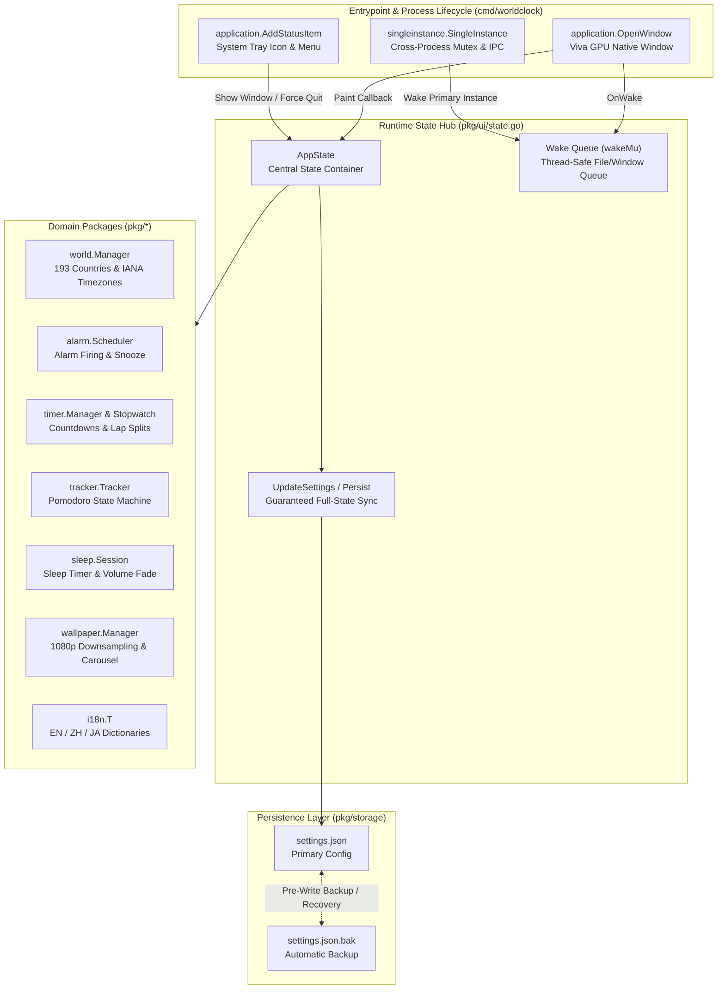
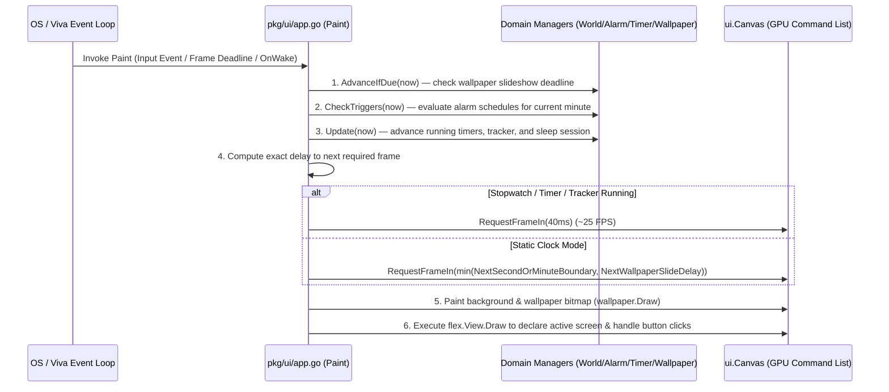

# World Clock Pro: Desktop Time, Alarms & Focus Timer — Complete Developer Guide

> **Document Version**: 1.0.0  
> **Target Audience**: Desktop Engineers, Go Developers, Maintainers  
> **Related Documents**: [中文开发文档](DEVELOPER_GUIDE_ZH.md) | [日本語開発ガイド](DEVELOPER_GUIDE_JA.md) | [Project Audit Report](PROJECT_AUDIT_REPORT.md)

---

## Table of Contents

1. [Project Overview & Design Philosophy](#1-project-overview--design-philosophy)
2. [Repository Structure & Module Responsibilities](#2-repository-structure--module-responsibilities)
3. [Core Architecture & Data Flow](#3-core-architecture--data-flow)
4. [Deep Dive into Core Subsystems](#4-deep-dive-into-core-subsystems)
   - [4.1 Application Lifecycle, Single-Instance Lock & System Tray (`cmd/worldclock` & `pkg/ui/app.go`)](#41-application-lifecycle-single-instance-lock--system-tray)
   - [4.2 Zero-Idle Redraw & Boundary Scheduling (`pkg/clock` & `pkg/ui/app.go`)](#42-zero-idle-redraw--boundary-scheduling)
   - [4.3 193-Country Catalog, Alias Disambiguation & Duplicate Prevention (`pkg/world` & `pkg/ui/view_world.go`)](#43-193-country-catalog-alias-disambiguation--duplicate-prevention)
   - [4.4 Zero-Overhead Wallpaper Carousel Engine (`pkg/wallpaper`)](#44-zero-overhead-wallpaper-carousel-engine)
   - [4.5 Crash-Safe Persistence & `.bak` Auto-Recovery (`pkg/storage`)](#45-crash-safe-persistence--bak-auto-recovery)
   - [4.6 Trilingual Localization Engine (`pkg/i18n`)](#46-trilingual-localization-engine)
5. [Viva UI Development Conventions](#5-viva-ui-development-conventions)
6. [Headless Testing & Verification (`app.Driver`)](#6-headless-testing--verification-appdriver)
7. [Windows Build, PE Resource Embedding & Authenticode Signing](#7-windows-build-pe-resource-embedding--authenticode-signing)
8. [How-To Guides for Common Extensions](#8-how-to-guides-for-common-extensions)

---

## 1. Project Overview & Design Philosophy

**World Clock Pro: Desktop Time, Alarms & Focus Timer** is a high-performance native desktop time suite built in Go on top of the [Viva](https://github.com/vivaui/viva) GPU-native UI framework. It runs without a WebView, HTML/CSS, or JavaScript engine, compiling into a single standalone binary (~8.1 MiB).

### Core Engineering Principles (Strictly Enforced by `AGENTS.md`)
1. **Declarative Value-Type Painting (`Painting is the UI`)**: The paint callback declares the screen using lightweight value types on each redraw. No retained DOM tree or manual layout cache invalidation is needed in application code.
2. **Zero Idle Redraw**: Background polling goroutines and heartbeat timers are strictly forbidden. An idle window draws nothing and consumes `0%` CPU/GPU. Redraws are scheduled exclusively at exact second/minute boundaries, wallpaper slide transitions, or active stopwatch ticks via `canvas.RequestFrameIn(delay)`.
3. **Zero Reflection in Render Paths**: `reflect` and `map[string]any` are never used in layout, input routing, or rendering.
4. **Single-Threaded UI State Machine with Wake Queue**: All `AppState` mutations occur on the UI thread. Asynchronous events (native file/folder pickers or secondary instance launch notifications) enqueue work onto a mutex-protected wake queue (`wakeMu`) and call `Invalidator.Invalidate()`, which executes on the UI thread via `cfg.OnWake`.

---

## 2. Repository Structure & Module Responsibilities

```text
the-world-clock-on-the-desktop/
├── cmd/
│   └── worldclock/
│       ├── main.go               # Entrypoint: single-instance lock, window startup, system tray menu
│       ├── main_test.go          # Entrypoint unit tests
│       └── resource_windows.syso # Native COFF PE resources (icon, version info, asInvoker manifest)
├── pkg/
│   ├── action/
│   │   ├── action.go             # Alarm trigger actions (HTTP/HTTPS validation, loopback blocking)
│   │   └── action_test.go
│   ├── alarm/
│   │   ├── alarm.go              # Alarm model, next trigger calculation, repeat summary formatting
│   │   ├── scheduler.go          # Alarm scheduler, per-minute idempotent firing, snooze & dismiss
│   │   └── alarm_test.go
│   ├── audio/
│   │   ├── synth.go              # Pure-Go procedural 16-bit PCM WAV synthesizer (alarm chimes & seamless ambient loops)
│   │   ├── audio.go              # Audio playback state coordinator, volume fade-out & sound preview
│   │   ├── player_windows.go     # Windows native winmm.dll (PlaySoundW / waveOutSetVolume) async driver
│   │   └── audio_test.go
│   ├── clock/
│   │   ├── clock.go              # 12H/24H formatting, exact boundary delay calculation, analog hand geometry
│   │   ├── location.go           # OS Country/Region, representative city & local timezone resolver
│   │   ├── location_windows.go   # Windows Kernel32 native GeoName, LocaleName & TimeZone detector
│   │   ├── lunar.go              # Offline Chinese Lunar Calendar (1900-2050), GanZhi, Zodiac & Dual Solar/Lunar Calendar
│   │   ├── lunar_test.go
│   │   ├── holiday.go            # World national holidays, 24 Solar Terms, Lunar festivals & internet/shopping events (1024, Black Friday, Double 11)
│   │   ├── holiday_test.go
│   │   └── clock_test.go
│   ├── i18n/
│   │   ├── i18n.go               # Full EN / ZH / JA translation dictionaries & localized date formatter
│   │   └── i18n_test.go
│   ├── rss/
│   │   ├── rss.go                # "On This Day in History" Baidu Baike / Wikipedia API fetcher & offline archive
│   │   └── rss_test.go
│   ├── sleep/
│   │   ├── sleep.go              # Sleep & ambient sound session state machine & linear volume fade-out
│   │   └── sleep_test.go
│   ├── storage/
│   │   ├── settings.go           # JSON persistence, deep-copy snapshots, .bak backup & corruption recovery
│   │   └── storage_test.go
│   ├── timer/
│   │   ├── timer.go              # Multi-timer countdown manager & progress fraction computation
│   │   ├── stopwatch.go          # Centisecond-precision monotonic stopwatch & lap split history
│   │   └── timer_test.go
│   ├── tracker/
│   │   ├── tracker.go            # Pomodoro productivity tracker (Work / Short Break / Big Break / DND)
│   │   └── tracker_test.go
│   ├── wallpaper/
│   │   ├── wallpaper.go          # Local wallpaper & carousel engine, 1080p downsampling, Fisher-Yates shuffle
│   │   └── wallpaper_test.go
│   ├── weather/
│   │   ├── weather.go            # Weather snapshot cache, °C/°F formatting & deterministic offline generator
│   │   └── weather_test.go
│   ├── world/
│   │   ├── world.go              # World clock manager, IANA timezone cache, multilingual search & ordering
│   │   ├── catalog.go            # Major world cities catalog & capital/country alias resolution (SameCityID)
│   │   ├── countries193.go       # Complete UN 193 countries catalog with EN/ZH/JA names & IANA timezones
│   │   └── world_test.go
│   └── ui/
│       ├── app.go                # Viva app.Config wiring, frame scheduling, close interception, tray icon
│       ├── state.go              # Runtime AppState, UpdateSettings sync wrapper, thread-safe wake queue
│       ├── ids.go                # Global ui.Tree & static/dynamic control ui.ID registry
│       ├── theme.go              # Built-in themes (Olive/Dark/Light/Nord), frosted glass & custom font colors
│       ├── scrollbar.go          # Sleek rounded pill scrollbar renderer
│       ├── view_main.go          # Main clock screen (digital frosted card / vector analog face + dock)
│       ├── view_world.go         # World clock screen, 193-country search modal & duplicate city dialog
│       ├── view_alarms.go        # Alarms list & new alarm creation modal
│       ├── view_timer.go         # Countdown timers & centisecond stopwatch screen
│       ├── view_tracker.go       # Productivity focus tracker (Pomodoro) screen
│       ├── view_sleep.go         # Low-light ambient sleep mode screen
│       ├── view_news.go          # News reader screen with localized articles
│       ├── view_settings.go      # 5-tab settings screen (Font / Wallpaper / Language / Clock / About)
│       ├── view_popout.go        # Compact desktop popout clock widget (top/center/bottom position alignment & dual calendar)
│       └── app_test.go           # 17 end-to-end headless UI tests powered by app.Driver
├── docs/
│   ├── DEVELOPER_GUIDE_ZH.md     # Chinese Developer Guide
│   ├── DEVELOPER_GUIDE_EN.md     # English Developer Guide (this file)
│   ├── DEVELOPER_GUIDE_JA.md     # Japanese Developer Guide
│   └── PROJECT_AUDIT_REPORT.md   # Project Audit Report
├── build_windows.ps1             # Windows build, Authenticode signing & release zip packaging script
└── README.md                     # Trilingual project README
```

---

## 3. Core Architecture & Data Flow

### 3.1 Subsystem Architecture Diagram



### 3.2 Per-Frame Paint & On-Demand Scheduling Sequence



---

## 4. Deep Dive into Core Subsystems

### 4.1 Application Lifecycle, Single-Instance Lock & System Tray

In [`cmd/worldclock/main.go`](file:///c:/XMWJJ/the-world-clock-on-the-desktop/cmd/worldclock/main.go):
1. **Single-Instance Enforcement**: Calls `singleinstance.SingleInstance("com.worldclockpro.desktop.v1", ...)`. When a second process is launched, `primary` is `false`; the second process immediately exits while the primary instance receives the IPC callback, invokes `state.RequestShowWindow()`, and restores/focuses its window even if hidden in the system tray.
2. **Close Button (`✕`) Interception**: In [`pkg/ui/app.go`](file:///c:/XMWJJ/the-world-clock-on-the-desktop/pkg/ui/app.go), `cfg.OnCloseRequest`:
   - Calls `state.Persist()` first so no state is ever lost.
   - If `state.ForceQuit` is true (user clicked "Exit Application" in the system tray) or `CloseBehavior == "exit"`, calls `allow()` and quits the application.
   - If `CloseBehavior == "minimize"` (the default), omits `allow()` and calls `state.Window.Hide()`, keeping the app alive in the system tray while alarms and timers continue running.

### 4.2 Zero-Idle Redraw & Boundary Scheduling

In [`pkg/clock/clock.go`](file:///c:/XMWJJ/the-world-clock-on-the-desktop/pkg/clock/clock.go), `NextBoundaryDelay(now, showSeconds)` computes `now.Truncate(time.Second).Add(time.Second).Sub(now)`:
- When seconds are visible, the window repaints once per second on the exact second boundary.
- When seconds are hidden and no fast timer is active, the window repaints once per minute on the exact minute boundary, resulting in `0%` CPU and GPU usage while idle.

### 4.3 193-Country Catalog, Alias Disambiguation & Duplicate Prevention

In [`pkg/world/catalog.go`](file:///c:/XMWJJ/the-world-clock-on-the-desktop/pkg/world/catalog.go) and [`pkg/world/world.go`](file:///c:/XMWJJ/the-world-clock-on-the-desktop/pkg/world/world.go):
- **Capital/Country Alias Resolution (`cityAliases`)**: Default cities use IDs like `"beijing"`, `"tokyo"`, `"london"`, whereas the 193-country catalog uses country IDs like `"china"`, `"japan"`, `"united-kingdom"`. [`CanonicalCityID`](file:///c:/XMWJJ/the-world-clock-on-the-desktop/pkg/world/catalog.go#L469-L474) and [`SameCityID`](file:///c:/XMWJJ/the-world-clock-on-the-desktop/pkg/world/catalog.go#L477-L482) unify these aliases across sorting, favoriting, removal, and duplicate detection.
- **Duplicate City Modal Alert**: In [`pkg/ui/view_world.go`](file:///c:/XMWJJ/the-world-clock-on-the-desktop/pkg/ui/view_world.go), already-added entries display `✓ Added` (`✓ 已添加` / `✓ 追加済み`). Clicking an existing city does not add a duplicate or close the picker modal; instead it populates `state.DuplicateCityAlert` and renders a native `f.Dialog` reminder modal.

### 4.4 Zero-Overhead Wallpaper Carousel Engine

In [`pkg/wallpaper/wallpaper.go`](file:///c:/XMWJJ/the-world-clock-on-the-desktop/pkg/wallpaper/wallpaper.go):
1. **Path-Only Indexing & On-Demand Single-Image Decoding**: `LoadFolder` and `LoadImages` store only lightweight file path strings (`[]string`), decoding only the currently displayed slide.
2. **Automatic 1080p Downsampling (`DownsampleImage`)**: Oversized 4K/8K photos are immediately downsampled on load so neither dimension exceeds `1920px`, releasing the full-resolution buffer and reducing RAM consumption by 75%–90%.
3. **Fast-Path RGBA Premultiplied Alpha Conversion**: `ImageToBitmapWithOpacity` operates directly on `*image.RGBA` byte slices, avoiding 2,000,000 interface calls per 1080p frame.
4. **Non-Repeating Shuffle (`OrderShuffle`)**: Uses a Fisher-Yates permutation (`shufflePerm`) that visits every image once per cycle and guarantees the first slide of a new cycle never repeats the last slide of the previous cycle.

### 4.5 Crash-Safe Persistence & `.bak` Auto-Recovery

In [`pkg/storage/settings.go`](file:///c:/XMWJJ/the-world-clock-on-the-desktop/pkg/storage/settings.go) and [`pkg/ui/state.go`](file:///c:/XMWJJ/the-world-clock-on-the-desktop/pkg/ui/state.go):
1. **Complete Default Initialization**: `DefaultSettings()` initializes `WorldCities` with `world.DefaultCities()`.
2. **Deep-Copy Isolation (`Store.Get()`)**: Every call to `Store.Get()` deep-copies `WorldCities`, `Alarms`, and `Wallpaper.ImagePaths`.
3. **Unified State Synchronization (`AppState.UpdateSettings`)**: Every UI setting toggle synchronizes live `World.Cities()`, `Scheduler.Alarms()`, and `Wallpaper.Config()` before writing to disk.
4. **Two-Phase `.bak` Backup & Self-Healing**: `saveLocked()` rotates the previous valid configuration into `settings.json.bak` before writing `settings.json`. If `settings.json` is ever corrupted on startup, `Load()` automatically restores from `settings.json.bak`.

### 4.6 Trilingual Localization Engine

[`pkg/i18n/i18n.go`](file:///c:/XMWJJ/the-world-clock-on-the-desktop/pkg/i18n/i18n.go) provides complete localization across three languages:
- `LangEN` (English): Uses **`ON` / `OFF`** for toggle states.
- `LangZH` (Simplified Chinese): Uses natural Chinese **`是` / `否`** for toggle states.
- `LangJA` (Japanese): Uses natural Japanese **`はい` / `いいえ`** for toggle states.

---

## 5. Viva UI Development Conventions

When adding or modifying screens, follow these rules:

1. **Declare Stable `ui.ID`s in `pkg/ui/ids.go`**:
   ```go
   IDMyNewButton = Tree.ID(featSettings, "btn-my-new-feature")
   ```
   Never generate transient IDs per frame or number hit targets by hand. For dynamic list items, use a mutex-guarded cache map like `CityRemoveID(cityID string)`.
2. **Handle Clicks Where Controls Are Declared**:
   ```go
   if f.Button(IDMyNewButton, state.T("my.label")).Outline().Clicked() {
       state.UpdateSettings(func(s *storage.Settings) {
           s.MySetting = true
       })
   }
   ```
3. **Unique IDs for Modal Dialog Regions**:
   When using `f.Dialog(flex.DialogSpec{...})`, always assign **distinct `ui.ID`s** to `Scope`, `DismissID` (backdrop), `CloseID` (corner close button), and footer action buttons.

---

## 6. Headless Testing & Verification (`app.Driver`)

All UI interactions can be verified headlessly without opening an OS window.

```powershell
# 1. Format and run static analysis
gofmt -w cmd pkg
go vet ./...

# 2. Run all unit & headless UI tests
go test ./... -count=1

# 3. Run UI end-to-end tests with verbose output
go test -v ./pkg/ui -count=1
```

---

## 7. Windows Build, PE Resource Embedding & Authenticode Signing

Run [`build_windows.ps1`](file:///c:/XMWJJ/the-world-clock-on-the-desktop/build_windows.ps1) from the repository root to compile, sign, and package the release:

```powershell
powershell -NoProfile -ExecutionPolicy Bypass -File .\build_windows.ps1
```

1. **Native PE Resource Linking (`.syso`)**: `cmd/worldclock/resource_windows.syso` embeds the multi-resolution icon (`RT_GROUP_ICON`), version metadata (`RT_VERSION`), and `asInvoker` manifest (`RT_MANIFEST`).
2. **Preserved Symbol Table for AV Cleanliness**: Builds with `-ldflags="-H=windowsgui"` without `-s -w`, preserving standard Go symbols and BuildID to prevent heuristic false positives from antivirus scanners.
3. **SHA-256 Authenticode Signature**: Signs `dist/WorldClockPro.exe` with a SHA-256 code-signing certificate and packages `dist/WorldClockPro-Windows-x64.zip`.

---

## 8. How-To Guides for Common Extensions

### 8.1 Adding a New Localization Key
1. Open [`pkg/i18n/i18n.go`](file:///c:/XMWJJ/the-world-clock-on-the-desktop/pkg/i18n/i18n.go).
2. Add the key to `translations[LangEN]`, `translations[LangZH]`, and `translations[LangJA]`.
3. Render it in any view via `state.T("your.new.key")`.

### 8.2 Adding a New Persisted Setting
1. Add the field with a `json` struct tag to `Settings` in [`pkg/storage/settings.go`](file:///c:/XMWJJ/the-world-clock-on-the-desktop/pkg/storage/settings.go).
2. Set its default value in `DefaultSettings()` and `unmarshalSettingsWithDefaults()`.
3. Update it in UI handlers via `state.UpdateSettings(func(s *storage.Settings) { ... })`.
