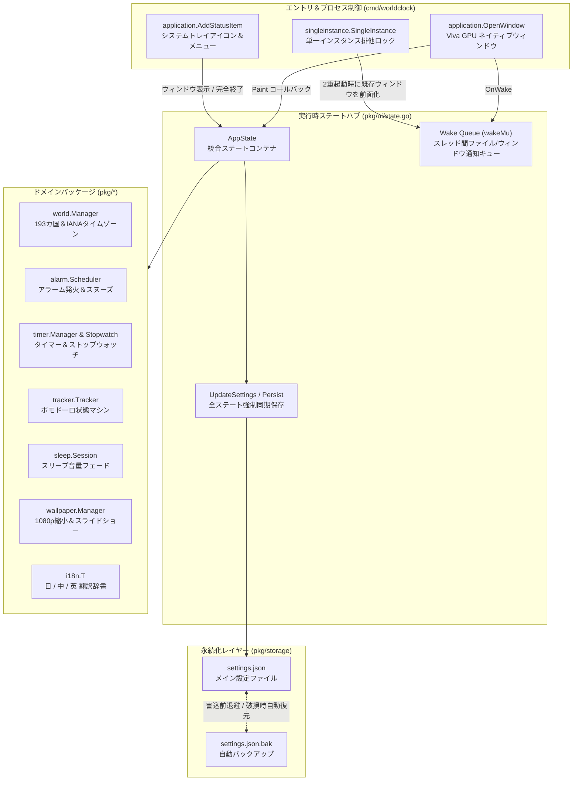

# World Clock Pro: Desktop Time, Alarms & Focus Timer — 完全開発ドキュメント (Developer Guide)

> **ドキュメントバージョン**：1.0.0  
> **対象読者**：デスクトップアプリ開発者、Goエンジニア、プロジェクトメンテナー  
> **関連ドキュメント**：[中文开发文档](DEVELOPER_GUIDE_ZH.md) | [English Developer Guide](DEVELOPER_GUIDE_EN.md) | [プロジェクト監査レポート](PROJECT_AUDIT_REPORT.md)

---

## 目次

1. [プロジェクト概要と設計思想](#1-プロジェクト概要と設計思想)
2. [ディレクトリ構造とモジュール責務](#2-ディレクトリ構造とモジュール責務)
3. [コアアーキテクチャとデータフロー](#3-コアアーキテクチャとデータフロー)
4. [主要サブシステムの詳細解説](#4-主要サブシステムの詳細解説)
   - [4.1 アプリライフサイクル、多重起動防止とシステムトレイ (`cmd/worldclock` & `pkg/ui/app.go`)](#41-アプリライフサイクル多重起動防止とシステムトレイ)
   - [4.2 アイドル時ゼロ描画と境界スケジューリング (`pkg/clock` & `pkg/ui/app.go`)](#42-アイドル時ゼロ描画と境界スケジューリング)
   - [4.3 世界193カ国カタログ、エイリアス解決と重複追加アラート (`pkg/world` & `pkg/ui/view_world.go`)](#43-世界193カ国カタログエイリアス解決と重複追加アラート)
   - [4.4 ゼロ常駐オーバーヘッドの壁紙スライドショーエンジン (`pkg/wallpaper`)](#44-ゼロ常駐オーバーヘッドの壁紙スライドショーエンジン)
   - [4.5 クラッシュセーフ永続化と `.bak` 自動復旧エンジン (`pkg/storage`)](#45-クラッシュセーフ永続化と-bak-自動復旧エンジン)
   - [4.6 3言語（日・中・英）ローカライズ基盤 (`pkg/i18n`)](#46-3言語日中英ローカライズ基盤)
   - [4.7 太陰太陽暦・干支・十二支エンジン (`pkg/clock/lunar.go`)](#47-太陰太陽暦干支十二支エンジン)
   - [4.8 世界の祝日・二十四節気・ネット記念日エンジン (`pkg/clock/holiday.go`)](#48-世界の祝日二十四節気ネット記念日エンジン)
   - [4.9 ポップアウト時計と3段階垂直レイアウト切替 (`pkg/ui/view_popout.go`)](#49-ポップアウト時計と3段階垂直レイアウト切替)
   - [4.10 タイマーの自由追加・編集・削除と永続化 (`pkg/timer` & `pkg/ui/view_timer.go`)](#410-タイマーの自由追加編集削除と永続化)
   - [4.11 OS起動時の自動実行連携 (`pkg/ui/autostart.go` & `cmd/worldclock/main.go`)](#411-os起動時の自動実行連携)
   - [4.12 画面端でのミニバー自動縮小と復元 (`pkg/ui/edgebar.go` & `pkg/ui/view_edgebar.go`)](#412-画面端でのミニバー自動縮小と復元)
5. [Viva フレームワーク UI 開発規約](#5-viva-フレームワーク-ui-開発規約)
6. [ヘッドレステストと検証ワークフロー (`app.Driver`)](#6-ヘッドレステストと検証ワークフロー-appdriver)
7. [Windows ビルド、PE リソース埋め込みと Authenticode 署名](#7-windows-ビルドpe-リソース埋め込みと-authenticode-署名)
8. [機能拡張ガイド](#8-機能拡張ガイド)

---

## 1. プロジェクト概要と設計思想

**World Clock Pro: Desktop Time, Alarms & Focus Timer** は、Go言語と GPU ネイティブ・デスクトップフレームワーク [Viva](https://github.com/vivaui/viva) で構築されたオールインワンのデスクトップ時間管理スイートです。WebView や HTML/CSS/JavaScript ランタイムを一切使用せず、単一のネイティブ実行ファイル（約 8.1 MiB）として動作します。

### コア設計原則（`AGENTS.md` 準拠）
1. **宣言的・値型による描画（`Painting is the UI`）**：描画関数そのものが UI です。毎フレーム値型で画面構造を宣言し、複雑な DOM ツリーやレイアウトキャッシュの手動管理を行いません。
2. **アイドル時ゼロ描画（Zero Idle Redraw）**：バックグラウンドで常時回るポーリング Goroutine やハートビートタイマーは一切使用しません。アイドル時は CPU / GPU 使用率 `0%` で完全スリープし、秒/分の境界、壁紙切り替え時刻、またはストップウォッチ稼働時のみ `canvas.RequestFrameIn(delay)` で再描画を予約します。
3. **描画パスにおけるリフレクション排除**：レイアウト・入力ルーティング・レンダリング経路で `reflect` や `map[string]any` を使用しません。
4. **シングルスレッド UI ステートマシンと Wake キュー**：`AppState` の変更はすべて UI メインスレッドで行われます。非同期ファイル選択ダイアログや多重起動時のウィンドウ復元通知は、ミューテックス保護されたキュー（`wakeMu`）と `Invalidator.Invalidate()` を介して `cfg.OnWake` で安全に処理されます。

---

## 2. ディレクトリ構造とモジュール責務

```text
the-world-clock-on-the-desktop/
├── cmd/
│   └── worldclock/
│       ├── main.go               # エントリポイント：多重起動ロック、メインウィンドウ、システムトレイ
│       ├── main_test.go          # エントリポイント単体テスト
│       └── resource_windows.syso # Windows COFF PEリソース（アイコン、バージョン情報、マニフェスト）
├── pkg/
│   ├── action/
│   │   ├── action.go             # アラーム発火時アクション（HTTP/HTTPS検証、ループバック拒否）
│   │   └── action_test.go
│   ├── alarm/
│   │   ├── alarm.go              # アラームデータモデル、次回トリガー計算、繰り返し要約
│   │   ├── scheduler.go          # アラームスケジューラ、分単位の冪等発火、スヌーズと停止
│   │   └── alarm_test.go
│   ├── audio/
│   │   ├── synth.go              # 純Goプロシージャル 16-bit PCM WAV 音声合成器（アラーム音＆環境音シームレスループ）
│   │   ├── audio.go              # アラーム鳴動・睡眠環境音ループ・音量減衰・試聴ステート管理
│   │   ├── player_windows.go     # Windows ネイティブ winmm.dll (PlaySoundW / waveOutSetVolume) 非同期再生
│   │   └── audio_test.go
│   ├── clock/
│   │   ├── clock.go              # 12H/24Hフォーマット、秒/分境界遅延計算、アナログ針の座標計算
│   │   ├── location.go           # OSの国・地域、代表都市および現地タイムゾーンの自动検出
│   │   ├── location_windows.go   # Windows Kernel32 ネイティブ地域・タイムゾーン検出
│   │   ├── lunar.go              # 高精度旧暦・太陰暦アルゴリズム (1900-2050)、干支・十二支・太陽暦/旧暦両対応
│   │   ├── lunar_test.go
│   │   ├── holiday.go            # 世界各国の祝日、二十四節気、旧暦行事、ネット記念日（1024、ブラックフライデー、独身の日等）
│   │   ├── holiday_test.go
│   │   └── clock_test.go
│   ├── i18n/
│   │   ├── i18n.go               # 日 (ja) / 中 (zh) / 英 (en) 翻訳辞書と日付ローカライザ
│   │   └── i18n_test.go
│   ├── rss/
│   │   ├── rss.go                # 「今日は何の日（歴史）」Baidu Baike / Wikipedia API 非同期取得＆アーカイブ
│   │   └── rss_test.go
│   ├── sleep/
│   │   ├── sleep.go              # スリープ＆環境音セッション管理、終了前の音量フェードアウト計算
│   │   └── sleep_test.go
│   ├── storage/
│   │   ├── settings.go           # JSON設定永続化、ディープコピー取得、.bak自動バックアップと破損復旧
│   │   └── storage_test.go
│   ├── timer/
│   │   ├── timer.go              # マルチカウントダウンタイマー管理と進捗率計算
│   │   ├── stopwatch.go          # 1/100秒精度モノトニックストップウォッチとラップタイム記録
│   │   └── timer_test.go
│   ├── tracker/
│   │   ├── tracker.go            # ポモドーロ集中トラッカー（作業 / 小休憩 / 長休憩 / 集中モード）
│   │   └── tracker_test.go
│   ├── wallpaper/
│   │   ├── wallpaper.go          # 壁紙＆スライドショーエンジン、1080pダウンサンプリング、シャッフル再生
│   │   └── wallpaper_test.go
│   ├── weather/
│   │   ├── weather.go            # 都市別天気スナップショットキャッシュ、°C/°F変換、オフライン気象生成
│   │   └── weather_test.go
│   ├── world/
│   │   ├── world.go              # 世界時計マネージャ、IANAタイムゾーンキャッシュ、多言語検索、並び替え
│   │   ├── catalog.go            # 主要世界都市カタログと首都/国名エイリアス解決 (SameCityID)
│   │   ├── countries193.go       # 国連193カ国フルカタログ（日/中/英名称・首都・IANAタイムゾーン）
│   │   └── world_test.go
│   └── ui/
│       ├── app.go                # Viva app.Config 構築、再描画スケジューリング、閉じるボタン制御、トレイアイコン
│       ├── state.go              # 実行時状態 AppState、UpdateSettings 同期ラッパー、スレッドセーフ Wake キュー
│       ├── ids.go                # グローバル ui.Tree と全コントロール ui.ID レジストリ
│       ├── theme.go              # 4種のテーマ（Olive/Dark/Light/Nord）、すりガラス透過度・文字色合成
│       ├── scrollbar.go          # モダンなピル型角丸スクロールバー描画
│       ├── view_main.go          # メイン時計画面（デジタルすりガラスカード / アナログ文字盤 + ドック）
│       ├── view_world.go         # 世界時計一覧、193カ国検索モーダル、重複追加警告ダイアログ
│       ├── view_alarms.go        # アラーム一覧＆新規アラーム作成モーダル
│       ├── view_timer.go         # カウントダウンタイマー＆高精度ストップウォッチ画面
│       ├── view_tracker.go       # ポモドーロ生産性トラッカー画面
│       ├── view_sleep.go         # 暗所向けスリープ＆アンビエント画面
│       ├── view_news.go          # 3言語対応ニュースリーダー画面
│       ├── view_settings.go      # 設定画面（フォント / 壁紙スライドショー / 言語 / 時計・閉じる動作 / 情報）
│       ├── view_popout.go        # コンパクトなデスクトップポップアウト小窓画面（上部・中央・下部の表示位置切替対応）
│       └── app_test.go           # app.Driver による 17 個のエンドツーエンド・ヘッドレス UI テスト
├── docs/
│   ├── DEVELOPER_GUIDE_ZH.md     # 中国語開発ガイド
│   ├── DEVELOPER_GUIDE_EN.md     # 英語開発ガイド
│   ├── DEVELOPER_GUIDE_JA.md     # 日本語開発ガイド（本ファイル）
│   └── PROJECT_AUDIT_REPORT.md   # プロジェクト監査レポート
├── build_windows.ps1             # Windows ビルド、Authenticode 署名、リリース ZIP 作成スクリプト
└── README.md                     # 日・中・英 3言語対応プロジェクト README
```

---

## 3. コアアーキテクチャとデータフロー

### 3.1 サブシステム構成図



---

## 4. 主要サブシステムの詳細解説

### 4.1 アプリライフサイクル、多重起動防止とシステムトレイ

[`cmd/worldclock/main.go`](file:///c:/XMWJJ/the-world-clock-on-the-desktop/cmd/worldclock/main.go) にて：
1. **多重起動の防止（Single-Instance）**：`singleinstance.SingleInstance("com.worldclockpro.desktop.v1", ...)` を呼び出します。すでにアプリが起動している状態で2つ目のプロセスが起動されると、2つ目は即座に終了し、IPC経由で既存プロセスの `state.RequestShowWindow()` を呼び出して、トレイに隠れているウィンドウを再表示・フォーカスします。
2. **閉じるボタン（✕）の動作設定**：[`pkg/ui/app.go`](file:///c:/XMWJJ/the-world-clock-on-the-desktop/pkg/ui/app.go) の `cfg.OnCloseRequest` にて：
   - まず `state.Persist()` を実行し、世界時計やアラームの最新状態を保存します。
   - `CloseBehavior == "exit"`（直接終了）またはトレイメニューからの終了（`state.ForceQuit == true`）の場合は、`allow()` を呼んでプロセスを終了します。
   - `CloseBehavior == "minimize"`（デフォルト：バックグラウンドへ最小化）の場合は、ウィンドウを閉じずに `state.Window.Hide()` でシステムトレイへ格納し、バックグラウンドでアラームやタイマーを継続します。

### 4.2 アイドル時ゼロ描画と境界スケジューリング

[`pkg/clock/clock.go`](file:///c:/XMWJJ/the-world-clock-on-the-desktop/pkg/clock/clock.go) の `NextBoundaryDelay(now, showSeconds)` は、次の正秒（秒非表示時は次の正分）までの正確な残り時間を計算します：
- 秒表示が「はい」のときは1秒に1回のみ再描画；
- 秒表示が「いいえ」でタイマーが停止中のときは1分に1回のみ再描画され、アイドル時のハードウェア負荷は完全にゼロになります。

### 4.3 世界193カ国カタログ、エイリアス解決と重複追加アラート

[`pkg/world/catalog.go`](file:///c:/XMWJJ/the-world-clock-on-the-desktop/pkg/world/catalog.go) および [`pkg/world/world.go`](file:///c:/XMWJJ/the-world-clock-on-the-desktop/pkg/world/world.go) にて：
- **首都IDと国IDのエイリアス統合（`cityAliases`）**：初期都市の `"beijing"`、`"tokyo"`、`"london"` 等と、193カ国カタログの `"china"`、`"japan"`、`"united-kingdom"` 等を [`CanonicalCityID`](file:///c:/XMWJJ/the-world-clock-on-the-desktop/pkg/world/catalog.go#L469-L474) と [`SameCityID`](file:///c:/XMWJJ/the-world-clock-on-the-desktop/pkg/world/catalog.go#L477-L482) で同一都市として扱います。
- **重複追加の防止と警告ダイアログ**：[`pkg/ui/view_world.go`](file:///c:/XMWJJ/the-world-clock-on-the-desktop/pkg/ui/view_world.go) では、すでに追加済みの都市ボタンに `✓ 追加済み` と表示します。再度クリックされた場合は追加せず、モーダルを閉じずに `f.Dialog` で重複警告ダイアログを表示します。

### 4.4 ゼロ常駐オーバーヘッドの壁紙スライドショーエンジン

[`pkg/wallpaper/wallpaper.go`](file:///c:/XMWJJ/the-world-clock-on-the-desktop/pkg/wallpaper/wallpaper.go) では、大量の高解像度写真をスライドショーしてもPCの性能に影響を与えない設計を採用しています：
1. **パスのみをインデックス化＆オンデマンド単一デコード**：フォルダ読み込み時はファイルパス文字列（`[]string`）のみを保持し、現在表示中の1枚のみをデコードします。
2. **自動 1080p ダウンサンプリング（`DownsampleImage`）**：4K/8K 画像は読み込み時に長辺 `1920px` 以下へ即座に縮小し、元画像バッファを解放することでメモリ使用量を 75%〜90% 削減します。
3. **重複なしシャッフル再生（`OrderShuffle`）**：Fisher-Yates シャッフル順列（`shufflePerm`）により、全写真を一巡するまで同じ写真が重複せず、周回の境界でも直前の写真が連続しないことを保証します。

### 4.5 クラッシュセーフ永続化と `.bak` 自動復旧エンジン

[`pkg/storage/settings.go`](file:///c:/XMWJJ/the-world-clock-on-the-desktop/pkg/storage/settings.go) と [`pkg/ui/state.go`](file:///c:/XMWJJ/the-world-clock-on-the-desktop/pkg/ui/state.go) により、追加した世界時計の設定が消える問題を4重の仕組みで防止しています：
1. **初期値の完全セット**：`DefaultSettings()` が最初から `world.DefaultCities()` を保持。
2. **ディープコピーによる保護（`Store.Get()`）**：設定取得時にスライスをディープコピーし、外部からの意図しない書き換えを遮断。
3. **一括同期更新（`AppState.UpdateSettings`）**：どの設定項目を変更しても、メモリ上の最新の `WorldCities`、`Alarms`、`Wallpaper` を同時に同期してから保存。
4. **2段階バックアップ保存（`.bak`）**：`settings.json` を上書きする前に直前の正常な設定を `settings.json.bak` へ退避し、万一の破損時には起動時に `.bak` から自動復旧。

### 4.6 3言語（日・中・英）ローカライズ基盤

[`pkg/i18n/i18n.go`](file:///c:/XMWJJ/the-world-clock-on-the-desktop/pkg/i18n/i18n.go) では、アプリ全体の多言語辞書を一元管理しています：
- `LangJA`（日本語）：トグル状態は自然な **`はい` / `いいえ`** を徹底。
- `LangZH`（简体中文）：トグル状態は **`是` / `否`** を使用。
- `LangEN`（English）：トグル状態は **`ON` / `OFF`** を使用。

### 4.7 太陰太陽暦・干支・十二支エンジン

[`pkg/clock/lunar.go`](file:///c:/XMWJJ/the-world-clock-on-the-desktop/pkg/clock/lunar.go) では、1900年から2050年（計151年）を網羅する高精度オフライン太陰太陽暦アルゴリズムを実装しています：
1. **天文学コンパクトビットマスク（`lunarInfo`）**：閏月や各大月・小月（29日/30日）を24ビット整数で超軽量にエンコード。
2. **十干・十二支と生肖**：六十干支周期からその年の干支・十二支を自動算出（例：2026年 -> `旧暦 丙午年(馬年)`）。
3. **デュアルカレンダー出力**：`FormatDualCalendar(now, lang)` により、太陽暦（グレゴリオ暦）と太陰太陽暦を並記してメイン時計およびポップアウト小窓に高コントラスト表示。

### 4.8 世界の祝日・二十四節気・ネット記念日エンジン

[`pkg/clock/holiday.go`](file:///c:/XMWJJ/the-world-clock-on-the-desktop/pkg/clock/holiday.go) では、多面的な記念日推論システムを構築しています：
1. **二十四節気天文学計算**：21世紀（2000〜2099年）対応の回帰式 `computeSolarTermDay` により、立春・春分・立夏・立冬・冬至などの節気公暦日を正確に算出。
2. **相対・動的祝日推論**：感謝祭（11月第4木曜日）、ブラックフライデー（翌金曜日）、サイバーマンデー（翌月曜日）、国際プログラマーの日（年間256日目）、母の日・父の日を自動推論。
3. **ネット記念日＆セール祭**：1024プログラマーの日（10/24）、独身の日（11/11）、双12（12/12）、618商戦、520告白の日、円周率の日（3/14）、スターウォーズの日（5/4）などを網羅。
4. **各国祝日と祝日なし明示**：日本（JP）、中国（CN）、アメリカ（US）、イギリス（GB）、フランス（FR）に対応。当日に記念日が存在しない場合は「🎉 今日の祝日・記念日：なし」と明瞭に表示。
5. **世界時計連動**：各世界都市の現地日付と国コードに基づき、その都市で当日祝われている祝日をリアルタイム表示。

### 4.9 ポップアウト時計と3段階垂直レイアウト切替

[`pkg/ui/view_popout.go`](file:///c:/XMWJJ/the-world-clock-on-the-desktop/pkg/ui/view_popout.go) にて：
1. **88px 特大フォント表示**：コンパクトな小窓内で時間・デュアルカレンダー・祝日バッジを高い視認性で描画。
2. **上部・中央・下部のレイアウト切替**：小窓上部にある **[⬆ 上部]**、**[⏺ 中央]**、**[⬇ 下部]** ボタンにより、スペーサー（`f.Spacer()`）の動的挿入で時計の表示位置を瞬時に切り替え可能。
3. **設定の自動保存**：位置設定は `Settings.PopoutPosition` に保存され、再起動後も状態を維持。

### 4.10 タイマーの自由追加・編集・削除と永続化

[`pkg/timer/timer.go`](file:///c:/XMWJJ/the-world-clock-on-the-desktop/pkg/timer/timer.go) と [`pkg/ui/view_timer.go`](file:///c:/XMWJJ/the-world-clock-on-the-desktop/pkg/ui/view_timer.go) にて：
1. **カスタムタイマーの自由作成**：任意の名称と時・分・秒を指定して新規追加可能。お茶、ラーメン、昼寝、ポモドーロ、読書、ワークアウトの6大テンプレートを同梱。
2. **その場での編集＆削除**：各カードに `[✎ 編集]` と `[✕]` 削除ボタンを配置。変更は即座に `settings.json` へ保存。
3. **削除タイマーの復活防止**：`NewManagerWithTimers(initial []Timer)` では初期状態（`nil`）とユーザー設定（空スライスを含む非 `nil`）を厳格に区別し、削除したタイマーがアプリ再起動時に復活する不具合を根本的に防止。

### 4.11 OS起動時の自動実行連携

[`pkg/ui/autostart.go`](file:///c:/XMWJJ/the-world-clock-on-the-desktop/pkg/ui/autostart.go)、[`pkg/ui/state.go`](file:///c:/XMWJJ/the-world-clock-on-the-desktop/pkg/ui/state.go)、[`cmd/worldclock/main.go`](file:///c:/XMWJJ/the-world-clock-on-the-desktop/cmd/worldclock/main.go) にて：
1. **OS自動起動エントリの登録・解除**：Viva の `app.SetAutostart` をラップし、Windows の `Run` レジストリキーや macOS/Linux の自動起動設定を同期します。
2. **明示的な有効化 / 無効化ボタン**：**設定 → ⏰ 時計** の上部に **`✅ 自動起動を有効化`** と **`🚫 無効にする`** ボタンを配置し、ワンクリックで切り替え可能。

### 4.12 画面端でのミニバー自動縮小と復元

[`pkg/ui/edgebar.go`](file:///c:/XMWJJ/the-world-clock-on-the-desktop/pkg/ui/edgebar.go)、[`pkg/ui/view_edgebar.go`](file:///c:/XMWJJ/the-world-clock-on-the-desktop/pkg/ui/view_edgebar.go)、[`pkg/ui/window_windows.go`](file:///c:/XMWJJ/the-world-clock-on-the-desktop/pkg/ui/window_windows.go) にて：
1. **画面端接近検出 (`DetectScreenEdge`)**：`cfg.OnFrameChange` から現在のモニター作業領域を取得し、ウィンドウが画面端に近づいた際にミニバーモードへ移行します。
2. **スリムバー表示とワンクリック復元 (`DrawEdgeBar`)**：現在時刻と太陽暦・旧暦の日付のみをコンパクトに表示し、**`⤢ 通常表示に戻す`** ボタンで元のウィンドウサイズへ復元します。
3. **設定での有効 / 無効切り替え**：**設定 → ⏰ 時計** 最上部のカードで **`✅ ミニバー縮小を有効化`** と **`🚫 無効にする`** ボタンを提供しています。

---

## 5. Viva フレームワーク UI 開発規約

1. **`pkg/ui/ids.go` で安定した `ui.ID` を宣言する**：
   ```go
   IDMyNewButton = Tree.ID(featSettings, "btn-my-new-feature")
   ```
2. **コントロール宣言箇所でクリックを処理する**：
   ```go
   if f.Button(IDMyNewButton, state.T("my.label")).Outline().Clicked() {
       state.UpdateSettings(func(s *storage.Settings) {
           s.MySetting = true
       })
   }
   ```
3. **モーダルダイアログ（`f.Dialog`）の ID 分離**：
   `Scope`、`DismissID`（背景クリック）、`CloseID`（閉じるボタン）、フッターボタンにはそれぞれ異なる `ui.ID` を割り当ててください。

---

## 6. ヘッドレステストと検証ワークフロー (`app.Driver`)

ウィンドウを実際に開くことなく、すべての UI 操作と状態遷移を高速にテストできます。

```powershell
# 1. コード整形と静的解析
gofmt -w cmd pkg
go vet ./...

# 2. 全パッケージの単体テスト＆ヘッドレスUIテスト実行
go test ./... -count=1

# 3. UIテストの詳細出力
go test -v ./pkg/ui -count=1
```

---

## 7. Windows ビルド、PE リソース埋め込みと Authenticode 署名

リポジトリルートの [`build_windows.ps1`](file:///c:/XMWJJ/the-world-clock-on-the-desktop/build_windows.ps1) を実行すると、ビルド・デジタル署名・ZIPパッケージ作成が一括で行われます：

```powershell
powershell -NoProfile -ExecutionPolicy Bypass -File .\build_windows.ps1
```

1. **ネイティブ PE リソース（`.syso`）**：`cmd/worldclock/resource_windows.syso` によりアイコン・バージョン情報・マニフェストを埋め込みます。
2. **シンボル保持によるウイルス対策ソフト誤検知回避**：`-ldflags="-H=windowsgui"` のみを指定し、`-s -w` によるシンボル削除を行わないことで、ヒューリスティック誤検知を防止します。
3. **SHA-256 Authenticode 署名**：コード署名証明書で `dist/WorldClockPro.exe` に署名し、`dist/WorldClockPro-Windows-x64.zip` を生成します。
