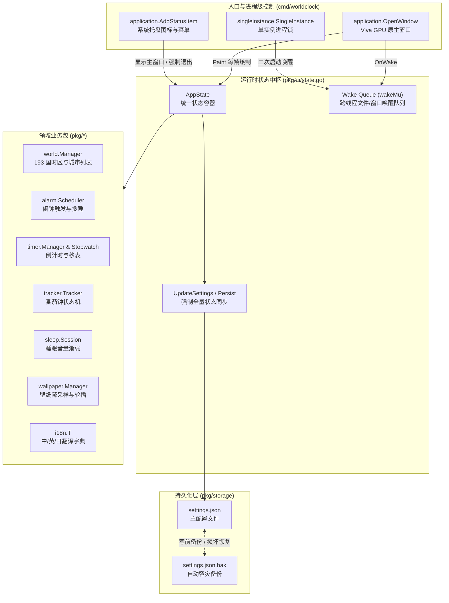
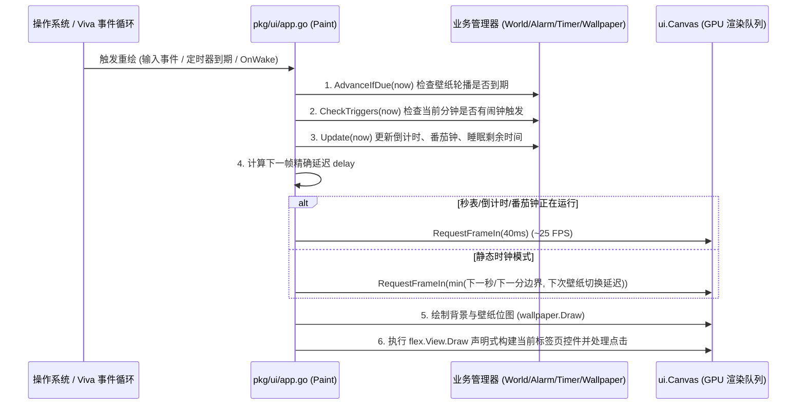

# 小瑞综合时钟桌面 (Xiaoru Integrated Clock Desktop) — 完整开发文档 (Developer Guide)

> **文档版本**：1.0.0  
> **适用对象**：桌面端工程师、Go 开发者、项目维护者  
> **关联文档**：[English Developer Guide](DEVELOPER_GUIDE_EN.md) | [日本語開発ガイド](DEVELOPER_GUIDE_JA.md) | [项目审计报告](PROJECT_AUDIT_REPORT.md)

---

## 目录

1. [项目概述与设计哲学](#1-项目概述与设计哲学)
2. [工程目录结构与模块职责](#2-工程目录结构与模块职责)
3. [核心架构与数据流图](#3-核心架构与数据流图)
4. [核心子系统深度解析](#4-核心子系统深度解析)
   - [4.1 应用生命周期、单实例锁与系统托盘 (`cmd/worldclock` & `pkg/ui/app.go`)](#41-应用生命周期单实例锁与系统托盘)
   - [4.2 零空闲重绘与精准边界调度 (`pkg/clock` & `pkg/ui/app.go`)](#42-零空闲重绘与精准边界调度)
   - [4.3 全球 193 国目录、别名消歧与重复提醒 (`pkg/world` & `pkg/ui/view_world.go`)](#43-全球-193-国目录别名消歧与重复提醒)
   - [4.4 零常驻开销的高性能壁纸轮播引擎 (`pkg/wallpaper`)](#44-零常驻开销的高性能壁纸轮播引擎)
   - [4.5 原子持久化与 `.bak` 容灾自愈引擎 (`pkg/storage`)](#45-原子持久化与-bak-容灾自愈引擎)
   - [4.6 多语言国际化体系 (`pkg/i18n`)](#46-多语言国际化体系)
   - [4.7 农历双历算法与天干地支生肖引擎 (`pkg/clock/lunar.go`)](#47-农历双历算法与天干地支生肖引擎)
   - [4.8 全球节假日、二十四节气与网络特色节日引擎 (`pkg/clock/holiday.go`)](#48-全球节假日二十四节气与网络特色节日引擎)
   - [4.9 悬浮时钟模式与三段垂直位置动态排版 (`pkg/ui/view_popout.go`)](#49-悬浮时钟模式与三段垂直位置动态排版)
   - [4.10 倒计时任务自定义增删改查与落盘机制 (`pkg/timer` & `pkg/ui/view_timer.go`)](#410-倒计时任务自定义增删改查与落盘机制)
   - [4.11 开机自动启动与系统登录项同步 (`pkg/ui/autostart.go` & `cmd/worldclock/main.go`)](#411-开机自动启动与系统登录项同步)
   - [4.12 靠近屏幕边缘自动缩小为状态条与防抖恢复 (`pkg/ui/edgebar.go` & `pkg/ui/view_edgebar.go`)](#412-靠近屏幕边缘自动缩小为状态条与防抖恢复)
5. [Viva 框架 UI 开发规范](#5-viva-框架-ui-开发规范)
6. [测试体系与无头验证 (`app.Driver`)](#6-测试体系与无头验证-appdriver)
7. [Windows 构建、PE 资源嵌入与数字签名打包](#7-windows-构建pe-资源嵌入与数字签名打包)
8. [常见扩展开发指南](#8-常见扩展开发指南)

---

## 1. 项目概述与设计哲学

**小瑞综合时钟桌面**（英文：**Xiaoru Integrated Clock Desktop**，日文：**小瑞総合時計デスクトップ**）是一款基于 Go 语言与 [Viva](https://github.com/vivaui/viva) GPU 原生桌面框架构建的现代化全功能时间工作台。应用无任何 WebView、HTML/CSS 或 JavaScript 运行时开销，编译后为单一原生可执行文件（约 8.1 MiB）。

### 核心设计准则（严格遵循 `AGENTS.md`）
1. **声明式值类型绘制（Painting is the UI）**：UI 即绘制函数，每帧重绘通过值类型声明界面布局，不在业务层维护脆弱的 DOM 或 Retained-Mode 节点树。
2. **零空闲重绘（Zero Idle Redraw）**：严禁后台轮询 Goroutine 或心跳 Timer。窗口静止时不产生任何 GPU 绘制；仅在整秒/整分边界、壁纸切换时刻或秒表运行时通过 `canvas.RequestFrameIn(delay)` 按需唤醒。
3. **零反射与强类型（Zero Reflection in Render Path）**：布局、输入路由与渲染路径严禁使用 `reflect` 或 `map[string]any`。
4. **单线程 UI 状态机与跨线程唤醒队列**：所有 `AppState` 状态变更均在 UI 主线程完成；文件选择对话框或单实例 IPC 唤醒通过互斥锁队列 + `Invalidator.Invalidate()` 交由 `OnWake` 回调处理。

---

## 2. 工程目录结构与模块职责

```text
the-world-clock-on-the-desktop/
├── cmd/
│   └── worldclock/
│       ├── main.go               # 应用入口：单实例互斥锁、主窗口打开、系统托盘菜单
│       ├── main_test.go          # 入口初始化单元测试
│       └── resource_windows.syso # Windows 原生 COFF 资源（图标、版本信息、asInvoker 清单）
├── pkg/
│   ├── action/
│   │   ├── action.go             # 闹钟触发附加动作（URL 安全性校验、环回地址拦截）
│   │   └── action_test.go
│   ├── alarm/
│   │   ├── alarm.go              # 闹钟数据模型、下次触发时间计算、重复周期摘要
│   │   ├── scheduler.go          # 闹钟调度器、分钟级幂等触发、贪睡（Snooze）与解除
│   │   └── alarm_test.go
│   ├── audio/
│   │   ├── synth.go              # 纯 Go 程序化 16-bit PCM WAV 音频合成器（闹钟泛音琶音与无缝循环白噪音）
│   │   ├── audio.go              # 闹钟响铃、助眠环境音循环、音量线性衰减与试听状态机
│   │   ├── player_windows.go     # Windows 原生 winmm.dll (PlaySoundW / waveOutSetVolume) 异步播放实现
│   │   └── audio_test.go
│   ├── clock/
│   │   ├── clock.go              # 12H/24H 格式化、整秒/整分重绘延迟计算、模拟表盘三角几何计算
│   │   ├── location.go           # 操作系统所在国家/地区、代表城市与本地时区自动识别
│   │   ├── location_windows.go   # Windows Kernel32 区域与系统时区原生检测
│   │   ├── lunar.go              # 高精度离线农历算法 (1900-2050)、天干地支、生肖与公历/农历双历格式化
│   │   ├── lunar_test.go
│   │   ├── holiday.go            # 世界各国法定节日、二十四节气、农历民俗与网络特色节日（1024程序员节、黑五打折、双11等）
│   │   ├── holiday_test.go
│   │   └── clock_test.go
│   ├── i18n/
│   │   ├── i18n.go               # 中 (zh) / 英 (en) / 日 (ja) 全量翻译键值表与本地化日期格式
│   │   └── i18n_test.go
│   ├── license/
│   │   ├── license.go            # 7 天全功能免费试用与 Pro 订阅管理（¥3/月、¥28/年 及免付测试版）
│   │   └── license_test.go
│   ├── rss/
│   │   ├── rss.go                # “历史上的今天”百度百科 / Wikipedia API 异步拉取、HTML 清洗与离线档案库
│   │   └── rss_test.go
│   ├── sleep/
│   │   ├── sleep.go              # 睡眠与白噪音会话状态机、末段音量线性渐弱算法
│   │   └── sleep_test.go
│   ├── storage/
│   │   ├── settings.go           # JSON 配置持久化、lastSaved 免写去重、GetPrefs 零分配读取、.bak 自动备份与损坏恢复
│   │   └── storage_test.go
│   ├── timer/
│   │   ├── timer.go              # 多路倒计时器数据模型、增删改查、TickAll 零分配刷新与进度百分比计算
│   │   ├── stopwatch.go          # 百分之一秒精度单调时钟秒表与计圈（Lap）历史
│   │   └── timer_test.go
│   ├── tracker/
│   │   ├── tracker.go            # 番茄工作法专注计时器（工作/短休/长休自动流转、±1m/±5m 微调与勿扰模式）
│   │   └── tracker_test.go
│   ├── wallpaper/
│   │   ├── wallpaper.go          # 本地壁纸与轮播引擎、1080p 降采样、顺序/洗牌算法、预设程序化壁纸
│   │   └── wallpaper_test.go
│   ├── weather/
│   │   ├── weather.go            # 城市天气快照缓存、摄氏/华氏度转换与离线确定性气象生成
│   │   └── weather_test.go
│   ├── world/
│   │   ├── world.go              # 世界时钟管理器、IANA 时区缓存、多语言检索、判重与排序
│   │   ├── catalog.go            # 核心国际城市目录、首都/国家同义词映射 (SameCityID)
│   │   ├── global_catalog.go     # 联合国 193 个主权国家完整中英日名称、首都与 IANA 时区表
│   │   └── world_test.go
│   └── ui/
│       ├── app.go                # Viva app.Config 构建、帧重绘调度、关闭拦截、系统托盘图标生成
│       ├── state.go              # 全局运行时状态 AppState、DailyClockMeta 按天缓存、FilteredCatalog 搜索缓存与唤醒队列
│       ├── ids.go                # 全局唯一 ui.Tree 与所有静态/动态控件 ui.ID 注册表
│       ├── theme.go              # 四大内置主题（Olive/Dark/Light/Nord）与毛玻璃透明度/字体颜色合成
│       ├── scrollbar.go          # 自定义现代圆角胶囊滚动条绘制器
│       ├── edgebar.go            # 窗口靠近屏幕边缘检测、防抖回差与状态条进入/恢复状态机
│       ├── view_main.go          # 主时钟视图（数字毛玻璃卡片 / 矢量模拟表盘 + 底部快捷悬浮栏）
│       ├── view_edgebar.go       # 屏幕边缘紧凑时间日期状态条视图与一键恢复按钮
│       ├── view_world.go         # 世界时钟列表视图、193 国搜索添加弹窗、重复添加提醒模态框
│       ├── view_alarms.go        # 闹钟列表视图与新建闹钟面板（支持 ±1小时/±5分钟/±1分钟精确进位借位微调）
│       ├── view_timer.go         # 倒计时器（支持 ±1小时/±10分/±1分/±15秒/±1秒精确微调）与高精度秒表视图
│       ├── view_tracker.go       # 生产力专注计时（番茄钟，支持 ±1分/±5分微调）视图
│       ├── view_sleep.go         # 极简暗光睡眠与环境音视图（支持 ±1分/±5分微调）
│       ├── view_news.go          # 历史上的今天视图与三语文章本地化
│       ├── view_pro.go           # Pro 会员订阅（¥3/月、¥28/年）与 7 天免费试用中心视图及弹窗
│       ├── view_settings.go      # 五大模块设置视图（🌐语言含字体定制 / 🖼️壁纸轮播 / ⏰时钟含温度单位与关闭行为 / 👑会员 / ℹ️关于）
│       ├── view_popout.go        # 紧凑型桌面悬浮小窗视图（支持顶/中/底三段垂直位置自由切换与双历大字）
│       └── app_test.go           # 基于 app.Driver 的 21 组端到端无头 UI 交互测试与性能基准测试
├── docs/
│   ├── DEVELOPER_GUIDE_ZH.md     # 中文完整开发文档（本文档）
│   ├── DEVELOPER_GUIDE_EN.md     # 英文完整开发文档
│   ├── DEVELOPER_GUIDE_JA.md     # 日文完整开发文档
│   └── PROJECT_AUDIT_REPORT.md   # 项目代码审计报告
├── build_windows.ps1             # Windows 编译、Authenticode 签名与发行版 ZIP 打包脚本
└── README.md                     # 中英日三语项目首页说明
```

---

## 3. 核心架构与数据流图

### 3.1 模块依赖与渲染管线



### 3.2 单帧绘制与按需唤醒时序（Zero-Polling Loop）



---

## 4. 核心子系统深度解析

### 4.1 应用生命周期、单实例锁与系统托盘

在 [`cmd/worldclock/main.go`](file:///c:/XMWJJ/the-world-clock-on-the-desktop/cmd/worldclock/main.go) 中：
1. **单实例互斥锁**：调用 `singleinstance.SingleInstance("com.xiaoru.clockdesktop.v1", ...)`。当用户第二次双击应用图标时，新进程检测到 `primary == false` 会立即退出，并通过 IPC 触发主实例的回调 `state.RequestShowWindow()`，将已最小化或隐藏在托盘的主窗口恢复并置顶。
2. **关闭按钮（✕）拦截机制**：在 [`pkg/ui/app.go`](file:///c:/XMWJJ/the-world-clock-on-the-desktop/pkg/ui/app.go) 的 `cfg.OnCloseRequest` 中：
   - 先调用 `state.Persist()` 确保所有最新配置落盘。
   - 若 `state.ForceQuit == true`（用户从托盘菜单点击“退出程序”）或 `CloseBehavior == "exit"`（用户在设置中选择了“直接退出程序”），调用 `allow()` 并退出应用。
   - 若 `CloseBehavior == "minimize"`（默认），不调用 `allow()`，而是调用 `state.Window.Hide()` 将窗口隐藏至系统托盘，后台闹钟与计时继续运行。

### 4.2 零空闲重绘与精准边界调度

在 [`pkg/clock/clock.go`](file:///c:/XMWJJ/the-world-clock-on-the-desktop/pkg/clock/clock.go) 中，`NextBoundaryDelay(now, showSeconds)` 利用 `now.Truncate(time.Second).Add(time.Second).Sub(now)` 计算距离下一个整秒（或整分）的精确剩余时长：
- 当开启秒显示时，每秒仅重绘 1 次；
- 当关闭秒显示且无活动倒计时/秒表时，每分钟仅重绘 1 次，CPU 与 GPU 占用率在空闲时严格为 `0%`。

### 4.3 全球 193 国目录、别名消歧与重复提醒

在 [`pkg/world/catalog.go`](file:///c:/XMWJJ/the-world-clock-on-the-desktop/pkg/world/catalog.go) 与 [`pkg/world/world.go`](file:///c:/XMWJJ/the-world-clock-on-the-desktop/pkg/world/world.go) 中：
- **国家与首都同义词映射（`cityAliases`）**：默认城市使用的是 `"beijing"`、`"tokyo"`、`"london"` 等城市 ID，而 193 国目录使用的是 `"china"`、`"japan"`、`"united-kingdom"` 等国家 ID。[`CanonicalCityID`](file:///c:/XMWJJ/the-world-clock-on-the-desktop/pkg/world/catalog.go#L469-L474) 与 [`SameCityID`](file:///c:/XMWJJ/the-world-clock-on-the-desktop/pkg/world/catalog.go#L477-L482) 将二者统一映射，确保排序、收藏、删除与判重完全一致。
- **重复添加拦截与模态框提醒**：在 [`pkg/ui/view_world.go`](file:///c:/XMWJJ/the-world-clock-on-the-desktop/pkg/ui/view_world.go) 的 `tryAddCityFromModal` 中，若 `state.World.AddCity(city.ID)` 返回 `false`，不关闭选城面板，而是设置 `state.DuplicateCityAlert` 并在界面顶层渲染 `f.Dialog` 模态提醒框。

### 4.4 零常驻开销的高性能壁纸轮播引擎

在 [`pkg/wallpaper/wallpaper.go`](file:///c:/XMWJJ/the-world-clock-on-the-desktop/pkg/wallpaper/wallpaper.go) 中，针对大量高分辨率本地照片轮播进行了专门的硬件性能优化：
1. **仅索引路径，按需单张解码**：`LoadFolder` 与 `LoadImages` 仅扫描目录并记录图片路径切片（`[]string`），绝不一次性把多张图片读入内存。
2. **自动 1080p 降采样（`DownsampleImage`）**：单张 4K/8K 原图解码后立即降采样至长边不超过 `1920px` 的紧凑 `*image.RGBA`，随后释放原图临时缓冲，内存占用降低 75%~90%。
3. **RGBA 快速位图转换通道**：`ImageToBitmapWithOpacity` 针对 `*image.RGBA` 直接按字节切片步进做预乘 Alpha 计算，避免每帧 200 万次 `color.Color` 接口动态派发。
4. **洗牌不重复算法（`OrderShuffle`）**：采用 Fisher-Yates 洗牌生成全排列 `shufflePerm`，保证每一轮随机播放完所有照片后才开启下一轮，且跨轮首尾绝不连续重复同一张照片。

### 4.5 原子持久化与 `.bak` 容灾自愈引擎

在 [`pkg/storage/settings.go`](file:///c:/XMWJJ/the-world-clock-on-the-desktop/pkg/storage/settings.go) 与 [`pkg/ui/state.go`](file:///c:/XMWJJ/the-world-clock-on-the-desktop/pkg/ui/state.go) 中，通过四重防护确保用户添加的世界时钟和闹钟永不丢失：
1. **默认值完整初始化**：`DefaultSettings()` 默认携带 `world.DefaultCities()`。
2. **深拷贝隔离（`Store.Get()`）**：每次读取配置都对 `WorldCities`、`Alarms`、`Wallpaper.ImagePaths` 执行深拷贝，杜绝外部切片引用污染。
3. **统一同步入口（`AppState.UpdateSettings`）**：任何 UI 开关修改设置时，自动将内存中最新的 `World.Cities()`、`Scheduler.Alarms()`、`Wallpaper.Config()` 合并写入。
4. **双阶段备份与损坏自愈**：`saveLocked()` 在覆写 `settings.json` 前先将上一版有效配置写入 `settings.json.bak`；`Load()` 启动时若检测到 `settings.json` 损坏或为空，自动从 `settings.json.bak` 恢复。

### 4.6 多语言国际化体系

在 [`pkg/i18n/i18n.go`](file:///c:/XMWJJ/the-world-clock-on-the-desktop/pkg/i18n/i18n.go) 中维护了三大语言字典：
- `LangZH`（简体中文）：所有开关状态统一使用符合中文习惯的 **`是` / `否`**。
- `LangEN`（English）：所有开关状态使用 **`ON` / `OFF`**。
- `LangJA`（日本語）：所有开关状态使用 **`はい` / `いいえ`**。

### 4.7 农历双历算法与天干地支生肖引擎

在 [`pkg/clock/lunar.go`](file:///c:/XMWJJ/the-world-clock-on-the-desktop/pkg/clock/lunar.go) 中，实现了跨越 1900 年至 2050 年（共 151 年）的高精度离线农历转换算法：
1. **紧凑天文编码表（`lunarInfo`）**：每个农历年使用一个 24 位十六进制整数编码，高 4 位表示闰月月份，中间 12 位（或 13 位）表示各月大小月天数（29 天或 30 天），低 4 位记录该年闰月天数，实现仅数千字节的零外部依赖超轻量体积。
2. **天干、地支与十二生肖**：基于甲子六十花甲循环自动推算干支年份与生肖（如 2026 年推导为 `丙午年 (马年)` / `Year of the Horse` / `馬年`）。
3. **公历/农历双历并排输出**：对外导出 `FormatDualCalendar(now, lang)`，根据当前界面语言生成本地化双历文本（中文：`📅 公历: ...` 与 `🌙 农历 ...`），并在主时钟与悬浮时钟中并排清晰展示。

### 4.8 全球节假日、二十四节气与网络特色节日引擎

在 [`pkg/clock/holiday.go`](file:///c:/XMWJJ/the-world-clock-on-the-desktop/pkg/clock/holiday.go) 中构建了强大的全日历事件推导系统：
1. **二十四节气百年高精度回归公式**：采用 21 世纪（2000-2099）天文常数与 `computeSolarTermDay` 算法，精确计算立春、清明、立夏、立秋、立冬、冬至等 24 节气在当年的实际公历日期。
2. **动态与相对节日推导**：
   - 感恩节（11 月第 4 个星期四）、黑色星期五（感恩节次日 `+1`）、网络星期一（感恩节后首个周一 `+4`）；
   - 国际程序员节（每年第 256 天，平年 9 月 13 日，闰年 9 月 12 日）；
   - 母亲节（5 月第 2 个星期日）、父亲节（6 月第 3 个星期日）。
3. **中国特色与现代网络节日**：1024 程序员节（10 月 24 日）、双 11（11 月 11 日）、双 12（12 月 12 日）、618 狂欢节、520/521 表白日、圆周率日（3 月 14 日）、星球大战日（5 月 4 日）等。
4. **多国法定假日与当日无节日兜底**：覆盖中国 (CN)、美国 (US)、日本 (JP)、英国 (GB)、法国 (FR) 的全部法定假日；若当天没有任何节日，标准化输出 “🎉 今日节日：无”（英：Today's Holiday: None，日：今日の祝日・記念日：なし）。
5. **世界时钟联动**：世界时钟列表中的每一座国际城市卡片均自动根据该城市的当地日期和所属国家代码实时检测并展示该国正在庆祝的节日与二十四节气。

### 4.9 悬浮时钟模式与三段垂直位置动态排版

在 [`pkg/ui/view_popout.go`](file:///c:/XMWJJ/the-world-clock-on-the-desktop/pkg/ui/view_popout.go) 中：
1. **大字号紧凑卡片**：主时间字号放大至 88px，并排清晰呈现公历、农历与节日徽章。
2. **顶/中/底三段垂直位置切换**：小窗顶部控制栏提供 **[⬆ 顶部]**、**[⏺ 居中]**、**[⬇ 底部]** 快速排版按钮。视图通过按需在时钟卡片上方或下方插入弹性拉伸 `f.Spacer()`，实现时钟在小窗内的靠顶、居中与靠底对齐。
3. **状态持久化**：位置偏好保存在 `Settings.PopoutPosition` 中，并在设置页面中的“时钟与关闭行为”提供同步配置项，退出重启后位置自动恢复。

### 4.10 倒计时任务自定义增删改查与落盘机制

在 [`pkg/timer/timer.go`](file:///c:/XMWJJ/the-world-clock-on-the-desktop/pkg/timer/timer.go) 与 [`pkg/ui/view_timer.go`](file:///c:/XMWJJ/the-world-clock-on-the-desktop/pkg/ui/view_timer.go) 中：
1. **自定义任务管理**：用户可点击“➕ 自定义任务”打开面板，自定义任务名称及精确的时、分、秒时长，并提供了泡茶、煮面、午休、番茄、阅读、健身 6 款快捷模板。
2. **就地编辑与删除**：列表每一项均提供 `[✎ 编辑]` 与 `[✕]` 删除按钮，编辑支持调整名称与初始时长并重置，删除操作同步持久化。
3. **防死灰复燃恢复逻辑**：`NewManagerWithTimers(initial []Timer)` 严格区分初始配置为 `nil`（首次安装初始化默认模板）与非 `nil`（用户主动保存的自定义切片，即使用户清空全部任务也保持为空切片），避免应用重启时被删除的任务重新出现的缺陷。

### 4.11 开机自动启动与系统登录项同步

在 [`pkg/ui/autostart.go`](file:///c:/XMWJJ/the-world-clock-on-the-desktop/pkg/ui/autostart.go)、[`pkg/ui/state.go`](file:///c:/XMWJJ/the-world-clock-on-the-desktop/pkg/ui/state.go) 与 [`cmd/worldclock/main.go`](file:///c:/XMWJJ/the-world-clock-on-the-desktop/cmd/worldclock/main.go) 中：
1. **跨平台系统自启注册**：封装 Viva 原生 `app.SetAutostart(app.Autostart{ID: "com.xiaoru.clockdesktop", Name: "Xiaoru Integrated Clock Desktop"}, enabled)`，在 Windows 下自动维护 `HKCU\Software\Microsoft\Windows\CurrentVersion\Run` 注册表项，在 macOS/Linux 下自动维护 LaunchAgent / XDG Autostart。
2. **显式双按钮设置交互**：在 **设置 → ⏰ 时钟** 卡片中同时提供 **`✅ 启用开机自启`**（`IDOptAutoStartEnable`）与 **`🚫 不启用`**（`IDOptAutoStartDisable`）双按钮，点击即刻持久化至 `Settings.AutoStart` 并同步系统启动项。
3. **启动路径自刷新与测试隔离**：程序每次启动时若 `AutoStart == true` 会自动刷新当前可执行文件路径；在 `go test` 单元测试环境下通过 `isTestBinary()` 自动跳过真实系统注册表修改，确保测试绝对干净。

### 4.12 靠近屏幕边缘自动缩小为状态条与防抖恢复

在 [`pkg/ui/edgebar.go`](file:///c:/XMWJJ/the-world-clock-on-the-desktop/pkg/ui/edgebar.go)、[`pkg/ui/view_edgebar.go`](file:///c:/XMWJJ/the-world-clock-on-the-desktop/pkg/ui/view_edgebar.go) 与 [`pkg/ui/window_windows.go`](file:///c:/XMWJJ/the-world-clock-on-the-desktop/pkg/ui/window_windows.go) 中：
1. **边缘接近检测 (`DetectScreenEdge`)**：通过 `cfg.OnFrameChange` 实时监听窗口内容矩形变化，结合 `MonitorFromPoint` / `GetMonitorInfoW` 获取当前显示器的可用工作区（自动排除系统任务栏）。当窗口靠近屏幕顶部（`<= 42px`）或左/右/下边缘（`<= 20px`）时自动触发边缘收缩。
2. **DPI 感知原生窗口缩放 (`platformShrinkWindowToEdgeBar`)**：在进入状态条前自动保存原窗口外框 `RECT`，并根据当前显示器 DPI（`GetDpiForWindow`）调用 `SetWindowPos` 将窗口缩小为 `560×118` 贴边紧凑横条。
3. **精简状态条视图与一键恢复 (`DrawEdgeBar` & `ExitEdgeBar`)**：状态条仅简洁呈现当前时间与公历/农历日期，右侧提供 **`⤢ 恢复正常`**（`IDBtnRestoreEdgeBar`）按钮。点击后恢复原窗口尺寸并向屏幕内部偏移 `64px` 安全距离，同时置位 `SuppressEdgeBarUntilMoveAway` 防抖锁，直到窗口完全离开边缘回差区（`IsClearlyInsideScreen`）后才重新允许下次边缘吸附。
4. **设置页启用/不启用开关**：在 **设置 → ⏰ 时钟** 最顶部提供 **`✅ 启用状态条收缩`**（`IDOptEdgeDockEnable`）与 **`🚫 不启用`**（`IDOptEdgeDockDisable`）双按钮及 **`➖ 立即缩为状态条`** 体验按钮。选择“不启用”时，不仅屏蔽拖动边缘自动收缩，还会自动隐藏主时钟底部控制栏上的快捷按钮。

---

## 5. Viva 框架 UI 开发规范

在本项目新增或修改界面时，请严格遵守以下模式：

1. **在 `pkg/ui/ids.go` 中声明稳定 `ui.ID`**：
   ```go
   // 静态按钮 ID
   IDMyNewButton = Tree.ID(featSettings, "btn-my-new-feature")
   ```
   切勿在绘制循环中每次拼接随机字符串或手写数字编号。若为列表动态项，请使用类似 `CityRemoveID(cityID string)` 的带锁映射表缓存 `ui.ID`。
2. **在控件声明处直接处理点击事件**：
   ```go
   if f.Button(IDMyNewButton, state.T("my.label")).Outline().Clicked() {
       state.UpdateSettings(func(s *storage.Settings) {
           s.MySetting = true
       })
   }
   ```
3. **模态弹窗（Dialog）的 ID 唯一性**：
   使用 `f.Dialog(flex.DialogSpec{...})` 时，`Scope`、`DismissID`（遮罩层点击）、`CloseID`（右上角关闭按钮）与底部确认按钮必须使用**互不相同的 `ui.ID`**，否则无头测试或命中检测会优先匹配遮罩层。

---

## 6. 测试体系与无头验证 (`app.Driver`)

本项目无需打开真实操作系统窗口即可验证全部 UI 交互逻辑。

### 常用测试命令

```powershell
# 1. 代码格式化与静态检查
gofmt -w cmd pkg
go vet ./...

# 2. 运行全量单元测试与无头 UI 快照测试
go test ./... -count=1

# 3. 单独运行 UI 端到端测试并查看详细日志
go test -v ./pkg/ui -count=1
```

### 编写 `app.Driver` 测试示例（参见 `pkg/ui/app_test.go`）

```go
func TestMyFeature(t *testing.T) {
    state, driver := setupTestApp(t)
    defer driver.Close()

    // 模拟点击导航栏进入设置页
    clickID(t, driver, TabSettingsID)

    // 断言屏幕快照中包含预期文本
    if !hasLabel(driver.Snapshot(), "Settings & Preferences") {
        t.Fatal("expected settings title on screen")
    }
}
```

---

## 7. Windows 构建、PE 资源嵌入与数字签名打包

项目根目录提供了自动化构建脚本 [`build_windows.ps1`](file:///c:/XMWJJ/the-world-clock-on-the-desktop/build_windows.ps1)，一键完成编译、防杀软误报签名与发布包压缩：

```powershell
powershell -NoProfile -ExecutionPolicy Bypass -File .\build_windows.ps1
```

### 构建流程说明
1. **PE 资源自动链接（`.syso`）**：`cmd/worldclock/resource_windows.syso` 包含应用高清图标（`RT_GROUP_ICON`）、版本信息（`RT_VERSION`）与标准权限清单（`asInvoker`），`go build` 会自动将其链接进 EXE。
2. **保留符号表避免启发式误报**：编译参数使用 `-ldflags="-H=windowsgui"` 隐藏控制台黑框，同时**不添加 `-s -w`**，保留完整 Go 符号表与 BuildID，避免卡巴斯基等杀毒软件将剥离符号的 Go 程序误判为加壳木马。
3. **SHA-256 Authenticode 数字签名**：自动查找或生成本地代码签名证书，对 `dist/小瑞综合时钟桌面.exe` 与 `dist/XiaoruIntegratedClockDesktop.exe` 进行 SHA-256 数字签名，并打包生成 `dist/小瑞综合时钟桌面-Windows-x64.zip`。

---

## 8. 常见扩展开发指南

### 8.1 如何新增一个国际化词条？
1. 打开 [`pkg/i18n/i18n.go`](file:///c:/XMWJJ/the-world-clock-on-the-desktop/pkg/i18n/i18n.go)。
2. 在 `translations[LangEN]`、`translations[LangZH]`、`translations[LangJA]` 三个字典中同步添加相同的 Key（例如 `"settings.new_opt"`）。
3. 在视图代码中通过 `state.T("settings.new_opt")` 获取当前语言文本。

### 8.2 如何新增一个持久化配置字段？
1. 在 [`pkg/storage/settings.go`](file:///c:/XMWJJ/the-world-clock-on-the-desktop/pkg/storage/settings.go) 的 `Settings` 结构体中添加字段及 `json` 标签。
2. 在 `DefaultSettings()` 和 `unmarshalSettingsWithDefaults()` 中设置合理的默认值（确保老版本用户的 `settings.json` 升级时拥有默认值）。
3. 在 UI 交互处调用 `state.UpdateSettings(func(s *storage.Settings) { ... })` 修改并自动持久化。
