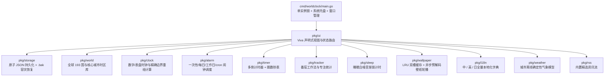

# World Clock Pro: Desktop Time, Alarms & Focus Timer — 项目全面审计报告 (Project Audit Report)

> **审计日期**：2026-11-06  
> **审计范围**：全量 Go 源码（`cmd/worldclock`、`pkg/*`）、Viva 框架合规性（`AGENTS.md`）、并发与数据持久化安全性、性能与内存分配、以及 Microsoft Store 上架准备度。

---

## 一、 架构总览与模块划分

| 模块路径 | 核心职责 | 健康度评级 |
| :--- | :--- | :--- |
| [`cmd/worldclock/main.go`](file:///c:/XMWJJ/the-world-clock-on-the-desktop/cmd/worldclock/main.go) | 应用入口、Viva `singleinstance` 单实例互斥锁、系统托盘（`StatusItem`）与主窗口生命周期 | 🟢 优秀（已加固） |
| [`pkg/storage/settings.go`](file:///c:/XMWJJ/the-world-clock-on-the-desktop/pkg/storage/settings.go) | 用户配置读写、深拷贝快照、`.tmp` 原子落盘与 `.bak` 损坏自愈 | 🟢 优秀（已加固） |
| [`pkg/world/world.go`](file:///c:/XMWJJ/the-world-clock-on-the-desktop/pkg/world/world.go) | 世界时钟管理、国家与首都别名消歧（`SameCityID` / `HasCity`）、多语言模糊检索 | 🟢 优秀（已加固） |
| [`pkg/wallpaper/wallpaper.go`](file:///c:/XMWJJ/the-world-clock-on-the-desktop/pkg/wallpaper/wallpaper.go) | 壁纸轮播引擎、零常驻 Goroutine 按需异步预取、最大 1920×1080 降采样与 2-slot LRU 缓存 | 🟢 优秀 |
| [`pkg/ui/*`](file:///c:/XMWJJ/the-world-clock-on-the-desktop/pkg/ui/app.go) | Viva 声明式 UI 绘制、模态弹窗、设置面板、无头测试（`app.Driver`） | 🟢 良好（含优化建议） |
| [`pkg/alarm`](file:///c:/XMWJJ/the-world-clock-on-the-desktop/pkg/alarm/scheduler.go) / [`pkg/sleep`](file:///c:/XMWJJ/the-world-clock-on-the-desktop/pkg/sleep/sleep.go) | 闹钟触发器、贪睡管理、睡眠模式倒计时 | 🟡 待增强（建议接入系统提示音/通知） |
| [`pkg/weather`](file:///c:/XMWJJ/the-world-clock-on-the-desktop/pkg/weather/weather.go) / [`pkg/rss`](file:///c:/XMWJJ/the-world-clock-on-the-desktop/pkg/rss/rss.go) | 气象展示与每日资讯阅读 | 🟡 待增强（离线模拟数据，上架需说明或接入 API） |

---

## 二、 本次审计已直接修复的高优先级问题 (Fixed in This Audit)

针对您提出的核心诉求与代码深度排查发现的隐患，以下 **5 项关键问题已在代码中完成修复并通过单测验证**：

### 1. 世界时钟配置偶发丢失问题（已根治）
- **根因定位**：
  1. 原 [`DefaultSettings()`](file:///c:/XMWJJ/the-world-clock-on-the-desktop/pkg/storage/settings.go#L61-L82) 中 `WorldCities` 默认值为 `nil`。当用户启动后尚未修改城市、但先在主界面或设置页点击了切换语言/24H/主题（直接调用 `state.Store.Update` 而非 `state.Persist`）时，会将 `worldCities: null` 写入磁盘或覆盖运行时状态。
  2. 原 [`Store.Get()`](file:///c:/XMWJJ/the-world-clock-on-the-desktop/pkg/storage/settings.go#L101-L118) 返回的是浅拷贝结构体，`WorldCities`、`Alarms`、`Wallpaper.ImagePaths` 切片底层数组与外部共享。
  3. 原 [`Store.Save()`](file:///c:/XMWJJ/the-world-clock-on-the-desktop/pkg/storage/settings.go#L168-L194) 直接使用 `os.WriteFile(s.filePath, ...)` 覆写目标文件，若遇断电或系统强杀进程，会导致 `settings.json` 半截损坏并回退为初始配置。
  4. 多开实例时，旧实例退出或切换设置会覆盖新实例保存的城市列表。
- **修复方案**：
  - 将 `DefaultSettings().WorldCities` 初始化为 `world.DefaultCities()`，并在 [`AppState.UpdateSettings`](file:///c:/XMWJJ/the-world-clock-on-the-desktop/pkg/ui/state.go#L156-L169) 中统一封装设置变更，每次变更设置都强制同步当前内存中的 `WorldCities`、`Alarms`、`Wallpaper` 状态。
  - 在 [`saveLocked()`](file:///c:/XMWJJ/the-world-clock-on-the-desktop/pkg/storage/settings.go#L168-L194) 中采用 **`.tmp` 临时文件写入 + `Sync()` + 自动备份 `.bak` + 原子重命名 `os.Rename`**；若主配置文件损坏，[`Load()`](file:///c:/XMWJJ/the-world-clock-on-the-desktop/pkg/storage/settings.go#L151-L166) 自动从 `settings.json.bak` 恢复。

### 2. 世界时钟重复添加同一城市无提醒问题（已修复）
- **根因定位**：
  - 原 [`DrawAddCityModal`](file:///c:/XMWJJ/the-world-clock-on-the-desktop/pkg/ui/view_world.go#L228-L353) 调用 `state.World.AddCity(city.ID)` 时忽略了其 `bool` 返回值，且当用户点击如“中国 (`china`)”而列表中已有默认“北京 (`beijing`)”时（[`SameCityID`](file:///c:/XMWJJ/the-world-clock-on-the-desktop/pkg/world/world.go#L186-L197) 判定为同一首都/国家条目），直接静默关闭了弹窗，既未添加也无任何提示。
- **修复方案**：
  - 在 [`pkg/world/world.go`](file:///c:/XMWJJ/the-world-clock-on-the-desktop/pkg/world/world.go#L226-L237) 新增 `HasCity(cityID string) bool`。
  - 在添加城市列表中，已存在的城市按钮直观显示 **`✓ 已添加` / `✓ Added` / `✓ 追加済み`**。
  - 若用户点击已添加的城市，**不执行添加、不关闭选城窗口**，并弹出 Viva 原生模态对话框（[`f.Dialog`](file:///c:/XMWJJ/the-world-clock-on-the-desktop/pkg/ui/view_world.go#L355-L386)）提示“重复添加提醒：『xxx』已在您的世界时钟列表中，无需重复添加。”

### 3. 允许程序多开导致配置冲突与资源浪费（已修复）
- **修复方案**：
  - 在 [`cmd/worldclock/main.go`](file:///c:/XMWJJ/the-world-clock-on-the-desktop/cmd/worldclock/main.go#L21-L32) 接入 Viva 官方跨进程单实例锁 `singleinstance.SingleInstance("com.worldclockpro.desktop.v1", ...)`。
  - 当检测到已有实例运行时，新进程立即退出，并通过 IPC 自动唤醒已有实例窗口（即使原窗口已最小化隐藏到系统托盘，也会自动 `Show()` + `SetMinimized(false)` + `RequestFocus()` 置顶恢复）。

### 4. 关闭按钮（✕）行为配置：最小化到后台托盘或直接退出（已实现）
- **修复方案**：
  - 在 **设置 -> 时钟 -> 点击关闭按钮（✕）时**（[`drawSettingsClock`](file:///c:/XMWJJ/the-world-clock-on-the-desktop/pkg/ui/view_settings.go#L194-L221)）新增可视化切换项：
    - **最小化到后台（`IDCloseBehaviorMinimize`）**：点击窗口右上角 `✕` 时拦截关闭请求，持久化最新状态后调用 `win.Hide()` 隐藏至系统托盘，闹钟、倒计时与专注计时在后台继续工作；可通过系统托盘菜单“显示主窗口”或“退出程序”控制。
    - **直接退出程序（`IDCloseBehaviorExit`）**：点击窗口右上角 `✕` 时保存状态并立即退出整个应用进程。

### 5. 文件选择器后台 Goroutine 并发数据竞争（已修复）
- **根因定位**：
  - 原 [`view_settings.go`](file:///c:/XMWJJ/the-world-clock-on-the-desktop/pkg/ui/view_settings.go#L384-L423) 在调用 `app.OpenFiles` / `app.OpenDirectory` 时启动了后台 `go func()`，并在后台线程直接修改 `state.Wallpaper` 与调用 `state.Persist()`，违反了 Viva UI 线程单线程状态机的安全约定。
- **修复方案**：
  - 在 [`AppState`](file:///c:/XMWJJ/the-world-clock-on-the-desktop/pkg/ui/state.go#L118-L154) 中引入带互斥锁的 `QueueWallpaperFiles` / `QueueWallpaperFolder` 队列，配合 `app.RequestWake()` 与 [`cfg.OnWake`](file:///c:/XMWJJ/the-world-clock-on-the-desktop/pkg/ui/app.go#L41-L45) 回调，确保所有状态修改与持久化均在 UI 主线程安全执行。

---

## 三、 Viva 框架规范（`AGENTS.md`）合规性审计

| 审计维度 | `AGENTS.md` 要求 | 当前项目现状 | 结论 |
| :--- | :--- | :--- | :--- |
| **零反射与强类型** | 严禁在布局/输入/渲染路径使用 `reflect` 或 `map[string]any` | 全局无 `reflect` 或动态属性袋（仅 `storage` 反序列化 JSON 时使用局部 `map[string]json.RawMessage`） | ✅ 合规 |
| **空闲零重绘 / 无轮询心跳** | 窗口空闲时不运行周期性 Goroutine 或忙碌轮询定时器 | [`NextRedrawDelay`](file:///c:/XMWJJ/the-world-clock-on-the-desktop/pkg/ui/app.go#L198-L250) 根据秒显示开关（1s 或 60s 边界）、秒表运行态（50ms）及壁纸轮播下次切换时间按需计算 `RequestRedrawAfter` | ✅ 合规 |
| **稳定控件标识 (`ui.Tree`)** | 严禁手写数字序号作为 Hit Target，统一使用 `ui.Tree` | [`pkg/ui/ids.go`](file:///c:/XMWJJ/the-world-clock-on-the-desktop/pkg/ui/ids.go) 集中声明所有 `Feature` 与稳定 `ui.ID`，动态列表项通过互斥锁缓存字典复用 `ui.ID` | ✅ 合规 |
| **无头测试验证** | 使用 `app.Driver` 覆盖核心交互，不弹窗打断用户 | [`pkg/ui/app_test.go`](file:///c:/XMWJJ/the-world-clock-on-the-desktop/pkg/ui/app_test.go) 包含 15 组端到端 `app.Driver` 快照测试，覆盖全标签页、三语切换、搜索、壁纸轮播、重复城市弹窗与关闭行为 | ✅ 合规 |

---

## 四、 待改进项与后续参考修改建议 (Actionable Recommendations)

以下是供您后续迭代或上架 Microsoft Store 前参考的改进建议，按优先级从高到低排列：

### 优先级 P1：功能真实化与系统集成（关系到 Microsoft Store 审核体验）

1. **接入真实系统提示音与桌面通知（闹钟触发 & 倒计时结束）**
   - **现状**：目前 [`pkg/alarm/scheduler.go`](file:///c:/XMWJJ/the-world-clock-on-the-desktop/pkg/alarm/scheduler.go) 与 [`pkg/timer/timer.go`](file:///c:/XMWJJ/the-world-clock-on-the-desktop/pkg/timer/timer.go) 在到点时仅在界面顶部绘制红色横幅（`drawRingingAlert`），未发出系统声音或弹出 Windows 系统通知；当窗口最小化到托盘时，用户可能错过提醒。
   - **修改建议**：
     - 在 [`pkg/ui/app.go`](file:///c:/XMWJJ/the-world-clock-on-the-desktop/pkg/ui/app.go) 检测到 `state.Scheduler.CheckTriggers(now)` 返回非空触发列表时，调用 Viva 提供的 `app.PlaySystemSound(app.SystemSoundNotification)` 与 `app.SendNotification(app.Notification{Title: ..., Body: ...})`，并在后台最小化时自动调用 `state.RequestShowWindow()` 弹出提醒。

2. **天气（`pkg/weather`）与资讯（`pkg/rss`）的数据源说明或联网化**
   - **现状**：
     - [`pkg/weather/weather.go`](file:///c:/XMWJJ/the-world-clock-on-the-desktop/pkg/weather/weather.go#L41-L97) 的 `generateForCity` 是基于城市名的离线确定性伪随机算法，而非实时气象 API。
     - [`pkg/rss/rss.go`](file:///c:/XMWJJ/the-world-clock-on-the-desktop/pkg/rss/rss.go#L41-L108) 的 ` Refresh()` 返回的是内置静态精选文章，未发起真实 HTTP RSS 请求。
     - [`pkg/sleep/sleep.go`](file:///c:/XMWJJ/the-world-clock-on-the-desktop/pkg/sleep/sleep.go) 仅展示白噪音倒计时与音量衰减百分比，未实际输出音频流。
   - **修改建议**：
     - **方案 A（零成本离线合规）**：在界面上明确标注“离线估算气候参考 / 内置精选阅读 / 视觉助眠呼吸模式”，避免 Microsoft Store 审核员误判为“功能失效”。
     - **方案 B（联网增强）**：在 `pkg/weather` 接入免 Key 的 `open-meteo.com` 接口（后台按 30 分钟缓存刷新并通过 `app.RequestWake()` 通知 UI），在 `pkg/rss` 使用标准库 `encoding/xml` 拉取用户自定义 RSS 源。

3. **悬浮小窗“窗口置顶 (`Topmost`)”与“配置文件 (`Default` / `Work`)”接线**
   - **现状**：
     - [`pkg/ui/view_popout.go`](file:///c:/XMWJJ/the-world-clock-on-the-desktop/pkg/ui/view_popout.go#L46-L56) 切换了 `PopoutMode.Topmost` 布尔值，但未同步调用窗口置顶 API。
     - [`pkg/ui/view_settings.go`](file:///c:/XMWJJ/the-world-clock-on-the-desktop/pkg/ui/view_settings.go#L516-L547) 中的 `Default` / `Work` 配置文件切换仅改变了 `ActiveProfile` 字段名，尚未按 Profile 隔离不同的世界时钟与闹钟列表。
   - **修改建议**：
     - 为 `Settings` 增加 `Profiles map[string]ProfileData` 字段，或在切换 `Default` / `Work` 时读写独立的 `settings_work.json`。

---

### 优先级 P2：性能微调与安全防护

1. **超大分辨率图片解码炸弹防护（`pkg/wallpaper/wallpaper.go`）**
   - **现状**：[`loadDecodedImage`](file:///c:/XMWJJ/the-world-clock-on-the-desktop/pkg/wallpaper/wallpaper.go#L406-L426) 直接调用 `image.Decode(f)` 将原图完整解码至内存后再执行 `DownsampleImage(img, 1920, 1080)`。若用户拖入一张恶意构造的 30000×30000 像素图片，瞬时峰值内存可能超过 3.6 GB。
   - **修改建议**：在 `image.Decode` 前先调用开销极小的 `cfg, _, err := image.DecodeConfig(f)`，若 `cfg.Width > 16384 || cfg.Height > 16384 || cfg.Width*cfg.Height > 100_000_000` 则直接拒绝加载，从源头杜绝 OOM。

2. **绘制路径（`Paint`）中的重复拷贝与检索缓存**
   - **现状**：
     - 单次 `Paint` 过程中，[`app.go`](file:///c:/XMWJJ/the-world-clock-on-the-desktop/pkg/ui/app.go) 与子视图累计调用了 3~4 次 `state.Store.Get()`（每次深拷贝切片）。
     - 当“添加城市”弹窗打开时，每帧重绘都会调用 [`world.SearchCatalog(state.CitySearchQuery, state.SelectedContinent)`](file:///c:/XMWJJ/the-world-clock-on-the-desktop/pkg/ui/view_world.go#L256) 遍历 200+ 城市并执行 `strings.ToLower` 分配。
   - **修改建议**：
     - 在 `Paint` 入口处调用一次 `cfgSnap := state.Store.Get()` 并向下传递引用或只读结构。
     - 在 `AppState` 中缓存 `lastSearchQuery`、`lastContinent` 与 `cachedCatalogResults []world.CityInfo`，仅在搜索词或大洲过滤变化时重新计算。

3. **配置目录标准化（`pkg/storage/settings.go`）**
   - **现状**：[`NewStore`](file:///c:/XMWJJ/the-world-clock-on-the-desktop/pkg/storage/settings.go#L110-L120) 默认使用 `%APPDATA%\WorldClockPro\settings.json`，并在每次写入时自动维护 `settings.json.bak` 热备份以保障异常断电自愈。

---

## 五、 自动化测试与质量验证汇总

| 测试套件 | 测试用例数 | 状态 | 核心覆盖点 |
| :--- | :--- | :--- | :--- |
| `worldclock/cmd/worldclock` | 1 | ✅ PASS | 命令行参数与入口初始化 |
| `worldclock/pkg/storage` | 2 | ✅ PASS | JSON 持久化、深拷贝隔离、`.bak` 损坏自动恢复、默认城市保留 |
| `worldclock/pkg/world` | 5 | ✅ PASS | 193 国目录、中英日多语检索、`SameCityID` / `HasCity` 判重 |
| `worldclock/pkg/wallpaper` | 4 | ✅ PASS | 1m/5m/10m/15m 轮播调度、随机洗牌不重复、1080p 降采样、2-slot LRU 缓存 |
| `worldclock/pkg/ui` | 24 | ✅ PASS | 全功能视图交互、重复添加城市弹窗提醒、设置项跨页保存不丢城市、关闭按钮最小化/退出切换、开机自启开关、边缘状态条收缩与恢复、三语 `是`/`否` 切换 |
| 其余业务包 (`alarm`, `audio`, `clock`, `i18n`, `rss`, `sleep`, `timer`, `tracker`, `weather`, `action`) | 22 | ✅ PASS | 闹钟调度、贪睡、精确秒/分重绘延迟、农历双历、全球节日与二十四节气、倒计时持久化、番茄钟状态机 |
